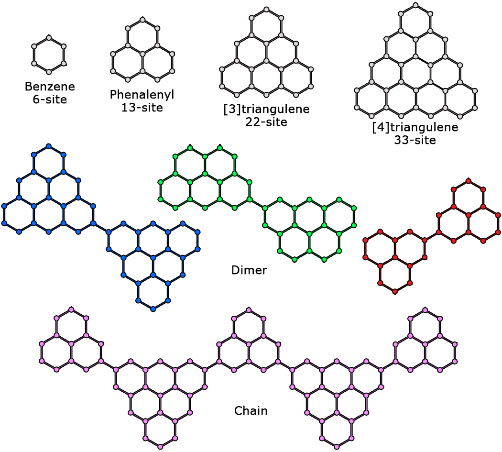

# Low Dimensional Spin Mapping (Lowdspin)

### Introduction
Lowdspin is a Python package for generating structural datasets of low-dimensional quantum simulator, including triangulene and related hexagon lattices. It maps charge and spin density distributions to investigate underlying electronic and magnetic properties. This tool is designed to automate and simplify the construction of diverse triangulene architectures, ranging from simple monomers to dimers and chain structures.

Key Outputs:
- Structure files: Ready-to-use geometry coordinates in .xyz and .dat formats.
- Electronic data: Calculated energy eigenvalues.
- Visualizations: Spatial maps of charge and spin density distributions.

### Methods
Hamiltonian:
$$\hat H = \hat H_{TB} + \hat H_U$$
 
Tight-Binding:
$$\hat H_{TB} = \Sigma_{ij,\sigma} t_{ij}\hat c_{i\sigma}^\dagger \hat c_{j \sigma}$$
 
Mean-field interaction on-site Hubbard U:
$$\hat H_U = U \Sigma_i \hat n_{i\uparrow}\hat n_{i\downarrow}$$

- last part of this class is group of functions to extract the positions, only consist of coordinates or with atom name such as Carbon thus we can add such as hydrogen using other software such as avogadro. In the beginning of installation the program will produce empty folder: structures, graphics, eigenvalues

-Analysis class: from here we start doing calculation, for TB, mean-field approximation, Hubbards. Visualizations function such as charge density and spin density. calculate expectation energy. asdd function to upload files that we already create. output: charge densities, spin densities, expectation energies

### How to install

### How to run
Prepare the design of triangulene you will make, create the sructure using functions in structure class and extract files. Next upload files back, create hamiltonian for tight binding, define your t values. let's say you are doing mean field approx, then go to mean-field function to create the hamiltonian, define U values for Hubard nearest neighbor cases. create graphics

